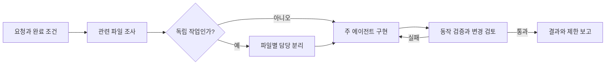

# 일을 나누고 끝내는 방식

이 저장소에서 하네스는 `AGENTS.md`의 작업 기준, `.codex/config.toml`의 실행 설정, `.vibe/project.json`의 완료 조건과 검사 명령, 그리고 `verify`의 종료 코드로 구성된다. 문서만으로 테스트 통과를 보장하지 않는다. 검사 명령을 실행한 결과가 완료 판단의 근거다.

## 한 작업의 흐름

사용자가 새 기능을 요청하면 주 에이전트가 입력·출력·실패 상황과 완료 조건을 파악한다. 저장소에서 확인할 수 있는 내용은 먼저 조사하고, 기능 자체를 바꿀 만큼 중요한 정보만 질문한다. 한두 파일의 수정에는 별도 계획 파일이나 병렬 작업이 필요하지 않다.

조사와 구현을 나눌 때는 explorer에게 관련 경로와 근거를 요청한다. 구현은 주 에이전트가 Ponytail로 기존 코드와 표준 기능을 활용하고, reviewer는 프로젝트의 Ponytail Review로 변경과 관련 호출부를 검토한다. 원인이 불명확한 실패는 디버깅 스킬로 재현부터 좁힌다. tester는 실제 검사 명령과 결과를 보고한다. 독립적인 구현을 나누는 경우에는 파일 소유권을 먼저 지정한다. 최대 하위 작업 3개는 한도이며 항상 3개를 만들라는 뜻이 아니다.

각 위임에는 목표, 수정 가능한 파일, 입력 자료, 완료 조건을 포함한다. 반환에는 바뀐 파일, 검사 결과, 미해결 항목을 담는다. 여러 에이전트가 같은 작업 디렉터리를 공유할 수 있으므로 별도 작업 공간이 자동으로 생겼다고 가정하지 않는다. 충돌 가능성이 큰 구현을 나눌 때는 별도 브랜치·worktree를 준비한다.

## 실제 사용할 요청 예시

> `$task-delivery`로 회원 목록 검색을 만들어줘. 현재 DB와 API 구조를 먼저 확인하고, 검색어가 없을 때와 결과가 없을 때도 처리해. UI 변경은 Playwright로 확인하고 기존 테스트까지 통과시켜줘.

> `$parallel-work`로 이 변경을 점검해줘. 한 명은 관련 호출 경로를 조사하고, 한 명은 회귀를 검토하고, 한 명은 테스트를 실행해. 코드 수정은 주 에이전트만 해.

> `$release-check`로 이번 변경을 게시해줘. 사용자가 승인한 대상과 범위를 확인하고, 검증 결과를 바탕으로 게시한 뒤 원격 상태까지 확인해.

## 종료 기준과 실패 대응

`verify`에 실제 앱의 빌드·테스트 명령을 등록한다. 검사가 하나도 없으면 기본적으로 실패한다. 명령은 문자열 배열로 실행되며 별도의 셸 해석을 하지 않는다. 임의 저장소에서 가져온 검사 명령은 실행 전에 읽는다. 배열 실행도 명령 자체의 신뢰성을 보장하지는 않는다.

같은 실패가 반복되면 원인 가설을 바꾸거나 범위를 좁힌다. 인증·결제·사용자 결정이 필요하면 그 부분을 분명히 알리고 독립적인 작업을 계속한다. 통과하지 않은 검사, 연결하지 못한 서버, 실행하지 않은 UI 흐름은 그대로 기록한다.

환경 설정은 특정 모델의 성능을 보장하지 않는다. 모델 표시 이름을 설정 파일의 모델 ID로 추측해 넣지 않고, 현재 Codex에서 선택 가능한 모델을 사용한다. 관리형 환경의 정책은 프로젝트 설정보다 우선할 수 있다.
