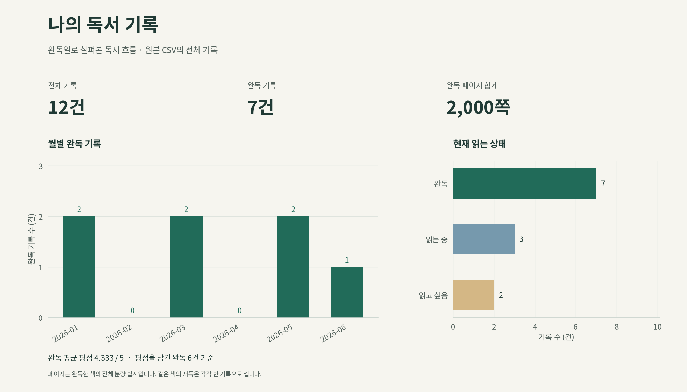

# 독서 기록으로 비교하는 5가지 개발 환경

같은 독서 기록 주제를 웹·API·분석·작은 도구·자동화로 구현했다. 각 예제는 독립적으로 실행하며 입력 형식과 저장 위치는 각 README에 적었다. 소스, 검사, 공개 가능한 가상 샘플, 실제 실행 결과를 함께 제공한다.

| 목적·프로필 | 만든 것 | 소스와 실행 방법 | 실제 결과 |
| --- | --- | --- | --- |
| `web` | 책 등록·검색·수정·삭제, 브라우저 저장 | [웹앱](web/README.md) | [화면과 확인 기록](web/results/README.md) |
| `api` | Bearer 인증, 책 CRUD·검색·페이지 조회, SQLite | [독서 API](api/README.md) | [요청·응답과 OpenAPI](api/results/README.md) |
| `data` | CSV 검증·집계, 한국어 표·보고서·차트 | [CSV 분석](data/README.md) | [분석 보고서](data/results/report.md), [차트](data/results/reading-summary.png) |
| `minimal` | JSON 독서 기록에서 제목·저자·상태 검색 | [검색 도구](minimal/README.md) | [실행 결과](minimal/results/README.md) |
| `automation` | 주간 독서 요약 미리보기·생성·안전한 재실행 | [주간 요약 자동화](automation/README.md) | [실행·재실행 결과](automation/results/README.md) |



## 바로 실행하기

1. 이 저장소를 Template 또는 Fork로 가져와 clone한다.
2. 저장소 루트에서 `python scripts/setup.py --profile minimal`처럼 원하는 프로필을 적용한다. 기존 설정을 직접 바꿨다면 충돌 안내를 먼저 해결한다.
3. Codex에서 **저장소 루트**를 열고 새 채팅을 시작한다.
4. 위 표에서 해당 예제 README를 열고 의존성 복원 → 실행 → 검사 순서로 진행한다. 예제는 이미 구현되어 있으므로 첫 작업 지시를 다시 보내야 실행되는 구조가 아니다.

`minimal`은 Python3.11 이상만으로 실행한다. `automation` 앱도 표준 Python만 쓰지만 프로필 setup의 문서·브라우저 검사에는 Node22 이상이 필요하다. `web` 예제는 Node24.x 중24.15 이상, `api`는 Python3.11 이상, `data`는 잠금 의존성 때문에 Python3.12 이상이 필요하다. 실제 검사 환경과 결과는 [검증 기록](VERIFICATION.md)에 있다.

가장 작은 예제를 먼저 확인하려면 루트에서:

```powershell
python scripts/setup.py --profile minimal
python examples/reading/minimal/search.py --input examples/reading/minimal/samples/books.json --query 숲
python -m unittest discover -s examples/reading/minimal/tests -v
```

macOS/Linux에서 Python 실행 파일이 `python3`이면 그 이름으로 바꾼다. setup이 준비하는 것은 해당 프로필의 작업 지침·도구이며, 각 예제의 패키지 설치는 그 README에서 별도로 안내한다.

## 예제를 내 프로젝트로 이어가기

예제 폴더에서 바로 수정해도 되고, 필요한 예제 하나를 `apps/` 아래로 복사해 사용할 수도 있다. 옮겼다면 README·CI·검사 명령의 경로를 함께 맞춘다. `.venv`, `node_modules`, 로컬 DB나 개인 데이터를 복사해서 배포하지 않는다.

Codex에 이렇게 요청할 수 있다.

```text
examples/reading/automation을 내 프로젝트의 시작점으로 쓸게.
현재 automation 프로필을 확인하고 예제 README와 코드를 읽어줘.
이번에는 주간 요약에 완독 페이지 합계를 더 잘 보여주고 싶어.
원본 보존, dry-run, 중복 실행 방지, 기존 결과 검증을 유지하면서 고쳐줘.
.vibe/project.json에 이 예제의 실제 검사 명령을 등록하고 필요한 CI도 맞춰줘.
정상 실행과 두 번 실행, 실패 후 기존 결과 보존을 확인해줘.
```

각 예제의 `checks.example.json`에는 `.vibe/project.json`에 병합할 검사 항목이 있다. 기존 `checks`를 지우지 말고 필요한 항목만 더한다. Python API·데이터 예제는 먼저 그 폴더에 `.venv`와 의존성을 준비한다.

새 아이디어를 처음부터 만들려면 [웹](../../templates/first-task.md) · [API](../../templates/first-api-task.md) · [데이터](../../templates/first-data-task.md) · [작은 도구](../../templates/first-minimal-task.md) · [자동화](../../templates/first-automation-task.md) 양식을 사용한다.

## 결과와 개인 자료 구분

- `samples/`, `results/`는 이 저장소에서 만든 가상 자료와 공개 가능한 결과다. `results/`를 개인 분석의 출력 폴더로 사용하지 않는다.
- 개인 CSV·JSON은 각 예제의 `data/private/`, 새 분석·자동화 결과는 `output/`처럼 Git에서 제외된 위치에 둔다. 웹 데이터는 브라우저 localStorage, API 데이터는 로컬 SQLite에 저장된다.
- API의 `.env.example`에는 값이 없다. 본인 로컬 토큰을 만들어 사용한다. 실제 `.env`, 개인 DB, 브라우저 상태는 예제에 포함하지 않는다.
- 초기 조사 보고서와 상세 로컬 작업 로그는 게시하지 않았다. 여기에는 예제를 재현하는 데 필요한 명령과 확인한 결과만 정리했다.
- 폰트 등 가져온 자료는 해당 폴더의 출처·라이선스를 따른다. 직접 작성한 예제 코드는 저장소의 [MIT 라이선스](../../LICENSE)를 따른다.

`python scripts/vibe.py verify`는 현재 `.vibe/project.json`에 등록된 검사를 실행한다. 기본 구성에서는 starter 검사다. 위 예제의 검사는 각 README의 명령으로 실행하며, [GitHub Actions](../../.github/workflows/validate.yml)에서도 공개 예제를 별도로 검사한다.
