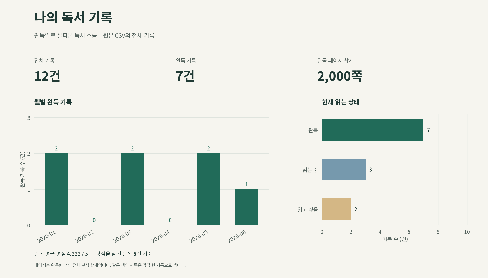

# 독서 기록 분석

전체 12건 중 완독은 7건입니다. 완독한 책의 전체 분량 합계는 2,000쪽입니다.

완독 평균 평점: **4.333 / 5**. 완독 중 평점을 남긴 6건만 분모로 사용했습니다. 미평점을 0점으로 계산하지 않았습니다.

## 지표와 한계

- 월별 집계는 finished_date의 달을 사용합니다. 첫 완독 달과 마지막 완독 달 사이의 기록 없는 달은 0입니다.
- pages는 책 전체 분량입니다. 미완독 책의 페이지나 하루 독서량을 합친 지표가 아닙니다.
- 같은 책의 재독은 다른 record_id를 가진 별도 기록으로 셉니다. 고유 도서 수와 다릅니다.
- 입력 오류가 있으면 일부 행을 버리고 계산하지 않고 전체 실행을 실패시킵니다.
- 개인 기록의 기술 통계입니다. 표본 밖의 독서 성향이나 인과관계를 추론하지 않습니다.

원본 SHA-256: `dc3cd4be27d9ae45213ee38de83e90d6aecbcb114348aeadbba1696e0010833f`

집계표는 monthly.csv와 status.csv, 구조화된 요약은 summary.json에 있습니다. 원본 제목·저자·개별 행은 결과에 복사하지 않았습니다.
