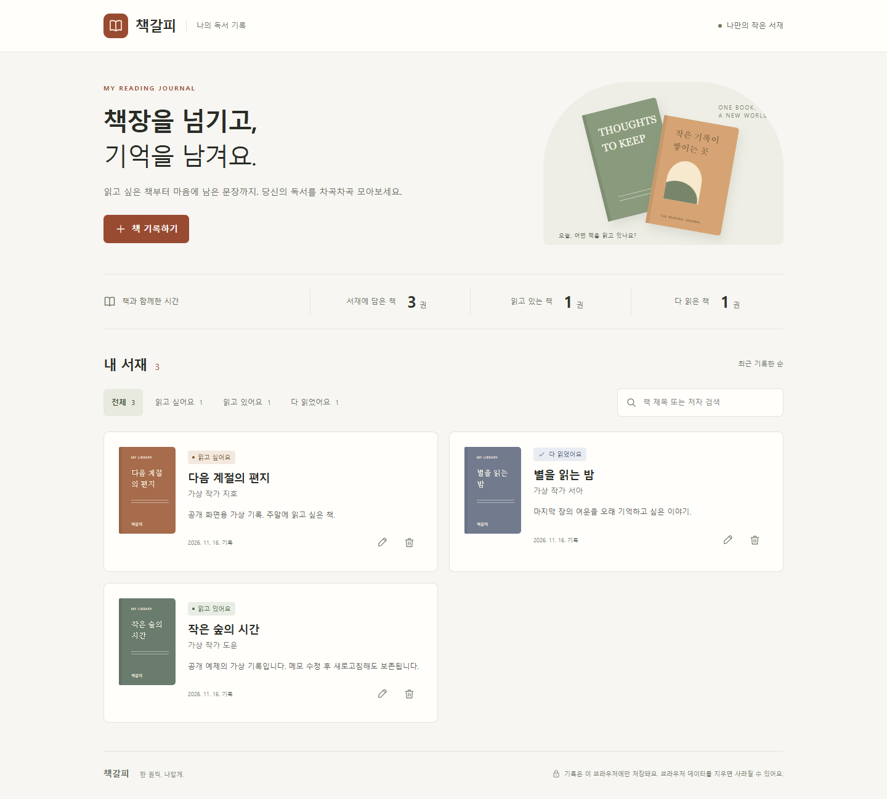
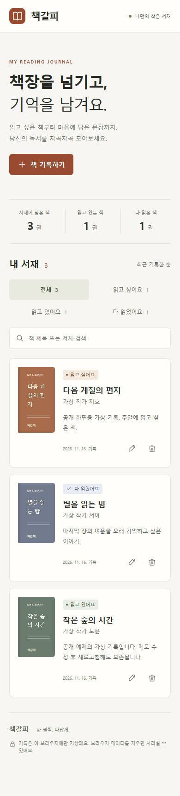

# web 예제 결과

2026-11-16에 공개 예제 폴더에 잠금 의존성을 새로 설치하고 다음을 실행했다.

```powershell
npm.cmd --prefix examples/reading/web ci
npm.cmd --prefix examples/reading/web run typecheck
npm.cmd --prefix examples/reading/web test
npm.cmd --prefix examples/reading/web run build
```

Node24.22.1·npm11.19.1에서 **타입 검사, 테스트16개, 빌드가 모두 통과**했다. 이는 `examples/reading/web` 복사본의 실제 결과다. `dist`와 설치 패키지는 게시하지 않는다.

최초 앱 제작 때는 별도 폴더의 실제 Chromium에서 CRUD·새로고침·검색·필터, 저장 실패·손상 데이터·탭 충돌, 모바일 가로 넘침·대화상자 포커스를 확인했다. 이 과거 검증을 이번 복사본의 새 브라우저 실행으로 간주하지 않는다. 이번 공개본의 브라우저 확인과 가상 데이터 화면은 아래에 별도로 기록한다.

기본 앱은 빈 서재이며 사용자 브라우저 데이터나 계정 상태를 결과물에 포함하지 않는다. 이 예제는 localStorage 기반 개인용 앱으로 서버 DB·기기 간 동기화·Safari/Firefox·실물 모바일 검증을 보장하지 않는다.

## 공개본의 실제 브라우저 확인

같은 날 공개본을 새 개발 서버로 실행하고 격리된 Playwright Chromium에서 아래 흐름을 다시 확인했다. localStorage를 직접 채우지 않고 화면의 입력 폼으로 가상 책3권을 등록했다.

- 빈 서재 → 등록3건 → 제목 검색1건 → 메모 수정 → 새로고침 후3건과 수정 내용 유지.
- 삭제 취소 후3건 유지와 원래 삭제 버튼으로 포커스 복귀 → 삭제 확인 후2건 → 가상 책 재등록 후3건.
- 390×844 모바일 화면에서 문서 폭과 화면 폭이 모두390px로 가로 넘침 없음.
- 1440×1100 PC 화면과 모바일 전체 페이지를 촬영해 글자·버튼·카드 배치를 직접 확인.

이번에는 위 흐름을 재실행했다. 이전 실습의 모든 오류·브라우저 조합을 다시 검사한 것은 아니다. 화면 속 책·저자·메모는 공개용 가상 자료이며 앱의 초기 데이터로 들어 있지 않다.

### PC



### 모바일


